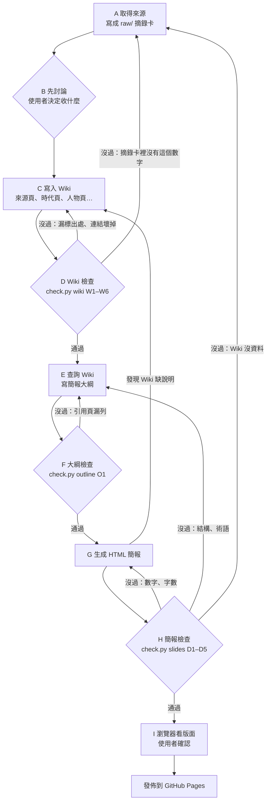

# CLAUDE.md — 任天堂歷史 LLM Wiki

這是一個「由 AI 維護、由人決定內容」的知識庫，主題是任天堂從 1889 年到現在的歷史。
Wiki 的用途是當作知識來源，產生給完全不熟任天堂的人看的教學簡報。

讀完這份文件，你應該知道：拿到一篇新資料時要怎麼收進 Wiki、怎麼從 Wiki 產生簡報，以及每一步要通過什麼檢查。

## 三層結構

| 層 | 路徑 | 誰寫 | 規則 |
|---|---|---|---|
| 原始來源 | `raw/` | 人＋AI 摘錄 | 一個來源一張「摘錄卡」，既有內容**不再修改**，漏記的只能在最後補充並標日期 |
| Wiki | `wiki/` | AI | 依來源整理成頁面，每一句事實都要標出處 |
| 規則 | `CLAUDE.md` | 人 | 就是這份文件 |

`raw/` 只放摘錄卡（來源資訊＋重點），不放原文全文。官方網站與新聞的原文有版權；Wikipedia 以 CC BY-SA 授權，摘錄時要寫明出處。

## 目錄

```
raw/s<編號>-<名稱>.md     摘錄卡，例：raw/s3-wiki-history.md
wiki/index.md             Wiki 目錄，每一頁都要列在這裡
wiki/log.md               所有操作的紀錄，只能往下加
wiki/sources/             每個來源一頁：重點、採用與不採用
wiki/eras/                時代頁（簡報的主要材料）
wiki/people/              人物頁
wiki/concepts/            概念頁
wiki/data/                數字資料頁
wiki/myths/               查證過、不採用的流傳說法
slides/outline.md         簡報大綱（每張投影片的內容與出處）
docs/index.html           教學 HTML 簡報（GitHub Pages 從 docs/ 發佈）
tools/check.py            自動檢查
```

檔名一律小寫英文加連字號。

## 出處規則（最重要）

- Wiki 裡每一條含有年份、數字或具體事實的句子，句尾都要標 `[S編號]`，例如 `1983 年推出紅白機 [S1]`
- `S編號` 必須對得到 `raw/` 裡的摘錄卡
- 兩個來源說法不同時，兩個都標，並在同一句說明差異，例如「1889 年開始做花札 [S1]；公司本身成立於 1947 年 [S1]」
- **數字一律以官方來源為準**：銷量用 S2，年份以 S1 為主，S1 沒寫的才用其他來源
- 寫進 Wiki 的數字，要**同時寫出簡報會用到的寫法**，簡報只能照抄 Wiki 的寫法，不能自己換算
- 自己算出來的數字（來源沒有直接寫），要寫出算式並註明「本 Wiki 計算」，例如「137 年（2026 − 1889 = 137，本 Wiki 計算）」，檢查程式會驗算
- 標了出處不等於出處裡真的有：句子裡的年份與數字，必須真的出現在它引用的摘錄卡裡（W6 會比對）。找不到就回到來源補摘錄，不能憑印象寫
- 找不到證據的說法不寫成事實，放進 `wiki/myths/`

## 流程圖



會重複執行的迴圈：C↔D（每收一篇來源都跑）、E↔F、G↔H；最外圈是 H→A，簡報需要的資料 Wiki 沒有時，回到最前面補來源，而且補來源一樣要先討論。

## 操作一：Ingest（收一篇新來源）

1. 讀來源，寫成 `raw/` 摘錄卡
2. **先討論、後生成**：把這篇的重點列給使用者看，問他要收哪些、有沒有不同意的地方。**使用者回覆之前，不能寫任何 Wiki 頁面**
3. 依使用者的決定寫 `wiki/sources/<編號>.md`：重點、採用、不採用與原因
4. 更新相關的時代頁、人物頁、概念頁；需要的話新增頁面
5. 更新 `wiki/index.md`
6. 跑 `python3 tools/check.py wiki`，沒通過就回到第 4 步修正
7. 在 `wiki/log.md` 記下：來源、討論結果、改了哪些頁、檢查結果

## 操作二：Query（從 Wiki 產生簡報）

1. 先讀 `wiki/index.md` 找相關頁面，再讀頁面內容。**只能用 Wiki 裡有的內容**，不能用你自己對任天堂的印象
2. 寫 `slides/outline.md`：每張投影片寫標題、要點、引用的 Wiki 頁面。**要點要寫出會出現在投影片上的年份**，不能只寫「三個轉折」這種概括說法
3. 跑 `python3 tools/check.py outline`：要點裡的年份都要在引用頁裡，沒過就回第 2 步補引用頁或改要點
4. 依大綱產生 `docs/index.html`。寫的過程中發現 Wiki 缺了需要的說明（例如某個名詞的解釋），先回 Wiki 補上、跑 `check.py wiki`，再寫進投影片
5. 跑 `python3 tools/check.py slides`
   - 數字或年份對不上 Wiki → 回第 4 步改投影片
   - 結構問題（缺學習目標、術語沒先解釋）→ 回第 2 步改大綱
   - **Wiki 裡根本沒有需要的資料 → 回到 Ingest 補來源，不能在簡報裡自己補**
6. 用瀏覽器實際看過每一張（桌機與手機），確認沒有文字超出版面
7. 給使用者看過才算完成，在 `wiki/log.md` 記下這次的檢查結果

## 操作三：Lint（定期檢查 Wiki）

`python3 tools/check.py wiki` 會檢查：

| 代號 | 檢查 |
|---|---|
| W1 | 含年份或數字的句子都有 `[S編號]` |
| W2 | `[S編號]` 都對得到 `raw/` 的摘錄卡 |
| W3 | 頁面之間的連結都存在 |
| W4 | 每一頁都列在 `index.md` |
| W5 | 「情趣旅館」這類已查證不採用的說法，只能出現在 `myths/`，或是明講「查無證據」 |
| W6 | 句子裡的年份與數字，真的出現在它引用的摘錄卡裡；「本 Wiki 計算」的算式要驗算正確 |

## 簡報規則

對象是**完全不熟任天堂的人**，所以：

- 依時間順序講，約 10 張
- 第一張要有「學習目標」，最後一張要有「重點回顧」和小測驗
- 要有一張「常見誤傳」，示範怎麼分辨流傳說法和有證據的事實
- 專有名詞第一次出現時要用 `<dfn>` 標起來並解釋，例如「<dfn>紅白機</dfn>（任天堂 1983 年的家用主機）」
- 每張投影片都要標出引用的 Wiki 頁面，網頁上要能點過去看
- 每張正文 200 字以內，講不完就拆成兩張或刪減

`python3 tools/check.py slides` 會檢查：

| 代號 | 檢查 |
|---|---|
| D1 | 每張投影片都標了 Wiki 出處，而且頁面存在 |
| D2 | 投影片上的每個年份與數字，都出現在它引用的 Wiki 頁面裡 |
| D3 | 第一張有學習目標、最後一張有回顧，總張數 8～12 張 |
| D4 | 指定的專有名詞第一次出現時有 `<dfn>` 解釋 |
| D5 | 每張正文 200 字以內 |

## 簡報風格

- 乾淨、留白多，一張只講一件事
- 鍵盤左右鍵、空白鍵翻頁，手機可以左右滑
- 不引入外部 JavaScript 函式庫，所有東西都在一個 HTML 檔裡
- 數字與年份用比較大的字，讓人一眼看到

## 不能做的事

- 修改 `raw/` 摘錄卡既有的內容（漏記的可以在卡片最後補充，標日期與原因）
- 使用者還沒回覆討論就寫 Wiki
- 在簡報裡放 Wiki 沒有的內容或數字
- 為了通過檢查而放寬 `tools/check.py`。檢查本身誤判時可以修正，但要在 `log.md` 寫明誤判了什麼、怎麼修
- 把查無證據的說法寫成事實
