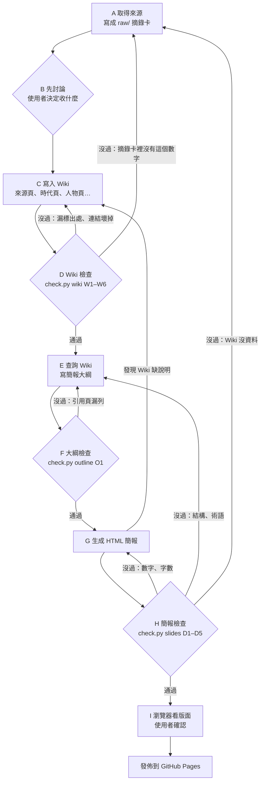

# 任天堂歷史 LLM Wiki

用 LLM Wiki 的方式整理任天堂從 1889 年到現在的歷史，再用這份 Wiki 當知識來源，產生給完全不熟任天堂的人看的教學 HTML 簡報。

- 教學簡報：https://eddie20041021.github.io/nintendo-history-wiki/
- Wiki 目錄：[wiki/index.md](wiki/index.md)
- 規則（schema）：[CLAUDE.md](CLAUDE.md)
- 操作與檢查紀錄：[wiki/log.md](wiki/log.md)

## 結構

```
raw/       6 張來源摘錄卡（S1–S6）
wiki/      AI 依規則整理的 Wiki：來源頁、時代頁、人物頁、概念頁、資料頁、誤傳頁
slides/    簡報大綱（每張投影片引用哪些 Wiki 頁）
docs/      教學 HTML 簡報（GitHub Pages）
tools/     自動檢查 check.py
```

## 流程



## 檢查

```
python3 tools/check.py wiki      # W1–W6：出處、連結、目錄、誤傳說法、數字對摘錄卡
python3 tools/check.py outline   # O1：大綱的年份都在引用的 Wiki 頁
python3 tools/check.py slides    # D1–D5：出處、數字對 Wiki、教學結構、術語解釋、字數
python3 tools/check.py all
```

只需要 Python 3，不用安裝任何套件。

## 來源

| 編號 | 來源 | 類型 |
|---|---|---|
| S1 | 任天堂官方「会社の沿革」 | 官方 |
| S2 | 任天堂 IR 主機與軟體累計銷量（截至 2026-09-30） | 官方 |
| S3 | Wikipedia「History of Nintendo」 | 百科（CC BY-SA 4.0） |
| S4 | Wikipedia「Gunpei Yokoi」 | 百科（CC BY-SA 4.0） |
| S5 | Wikipedia「Video game crash of 1983」 | 百科（CC BY-SA 4.0） |
| S6 | TechnoEdge「任天堂博物館 Direct」報導 | 新聞 |

摘錄卡只存重點與出處，不轉載原文。本專案為課堂作業，與任天堂無關；文中提到的商品名稱屬於各自的權利人。
